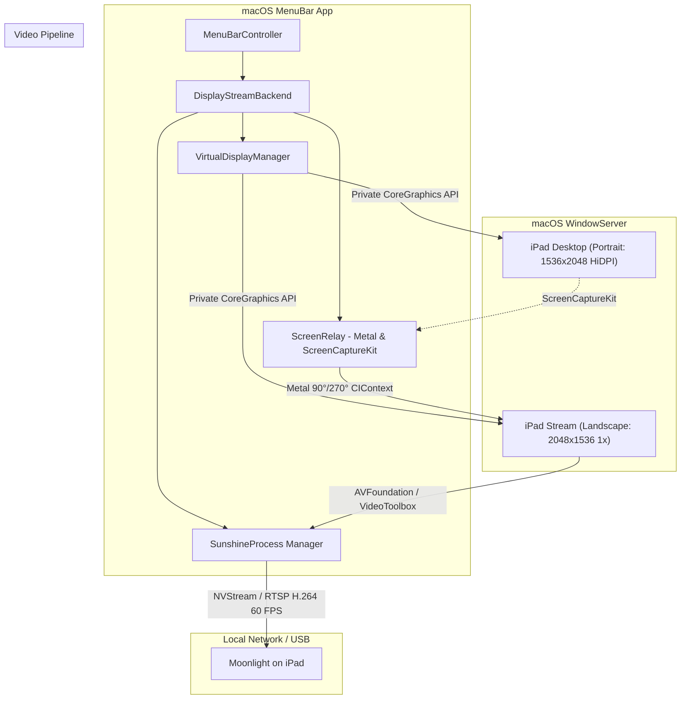

# iPad Display 🖥️📱

> **Turn any iPad into a high-performance, ultra-low-latency second monitor for your Mac.**  
> Powered by Apple Metal, ScreenCaptureKit, CoreGraphics Virtual Displays, and Sunshine / Moonlight.

[](https://www.apple.com/macos/)
[](https://swift.org)
[](https://moonlight-stream.org)
[](LICENSE)

---

## 💡 Why iPad Display?

Apple's native **Sidecar** requires modern iPads and Macs linked to the same Apple ID, leaving millions of older, perfectly capable iPads (like the iPad Air 1st/2nd Gen, iPad Mini 2–4, or iPad 5th/6th Gen) gathering dust. Third-party virtual display solutions are often clunky, charge subscriptions, require heavy kernel extensions, or produce laggy VNC streams with washed-out text and letterboxed portrait displays.

**iPad Display** is a native, menu-bar-only macOS application that seamlessly pairs Apple's private virtual display engine and hardware-accelerated **Metal** video pipelines with **Sunshine** and **Moonlight**. 

The result?
- **Silky 60 FPS streaming** with hardware H.264 / HEVC encoding via Apple VideoToolbox.
- **Native HiDPI ("Retina") text rendering** matching iPad native pixel density.
- **Flawless Portrait & Landscape modes with zero black bars**, overcoming Moonlight iOS's landscape-only streaming limitation using a custom dual-display Metal relay.
- **Zero system pollution**: Operates completely in user-space with no kexts or driver installs, keeping its configuration strictly isolated in `~/.config/ipad-display`.

---

## ✨ Features

- **MenuBar Companion**: Sits quietly in your menu bar (`LSUIElement`). No Dock icon clutter.
- **Hardware-Accelerated Portrait Relay**: Moonlight on iOS only accepts landscape frames. `iPad Display` creates a virtual portrait desktop for your Mac, captures it at 60 FPS via `ScreenCaptureKit`, rotates each frame 90° or 270° using **Metal** and **CoreImage**, and pipes it into Sunshine without host CPU overhead or letterboxing.
- **Crisp Retina / HiDPI Scaling**: 2048×1536 native pixels with 2x logical point scaling (1024×768 points) for razor-sharp typography.
- **Flexible Size Presets**:
  - **Full iPad**: 2048 × 1536 (iPad 9.7" Retina native)
  - **Balanced**: 1600 × 1200
  - **Light**: 1024 × 768
- **One-Click Pairing**: Pair your iPad directly through the menu bar by typing the 4-digit PIN shown on Moonlight—no web browser or command-line setup required.
- **Conflict-Free Sunshine Isolation**: Runs Sunshine in an independent sandbox (`~/.config/ipad-display`) with an ephemeral random local API key, coexisting peacefully with any global Sunshine installation.
- **Crash-Resilient Display Management**: Encodes display resolutions, refresh rates, and an incrementing generation counter into virtual display serial numbers to prevent macOS `WindowServer` state confusion.
- **Dual Audio & Interruption-Free Audio Modes**: Menu bar audio controls allow switching between **Mac Only (Blocked)** (Sunshine's audio tap is disabled, completely safeguarding Mac audio from interruption or muting) and **Mac + iPad (Dual Audio)** (streams audio to the iPad while keeping host Mac speakers active, outputting sound simultaneously from both devices for amplified loudness).

---

## 🏗️ Architecture Overview



### The Portrait Problem & The Metal Relay Solution

Moonlight's iOS client enforces a landscape rendering viewport. When streaming a portrait display directly, Moonlight either crushes the aspect ratio or introduces thick black borders with miniature text.

`iPad Display` solves this natively through **`ScreenRelay`**:
1. It creates two virtual displays:
   - **`iPad Desktop`** (e.g., 1536×2048, HiDPI): The actual monitor you see in macOS System Settings and interact with.
   - **`iPad Stream`** (e.g., 2048×1536, 1x): A dedicated, auxiliary virtual display.
2. `ScreenRelay` intercepts `iPad Desktop` framebuffers via `ScreenCaptureKit`.
3. It performs a 90° (Port Down) or 270° (Port Up) rotation in GPU hardware using a dedicated `CAMetalLayer` and `CIContext`.
4. The oriented texture renders borderless to `iPad Stream`, which Sunshine broadcasts.
5. On the iPad, holding the tablet upright naturally presents the upright desktop filling the entire physical glass!

---

## 🚀 Getting Started

### Prerequisites

1. **Mac**: macOS 13.0 (Ventura) or newer (Apple Silicon or Intel).
2. **iPad**: Any iPad capable of running the [Moonlight Game Streaming app](https://apps.apple.com/app/moonlight-game-streaming/id779656557) from the App Store.
3. **Sunshine**: Installed on your Mac.
   - Via Homebrew:
     ```bash
     brew install sunshine
     ```
   - Or placed at `/Applications/Sunshine.app` or specified via `SUNSHINE_BINARY=/path/to/sunshine`.

### Installation & Building

1. Clone this repository:
   ```bash
   git clone https://github.com/yourusername/ipad-display.git
   cd ipad-display
   ```

2. Open the project in Xcode:
   ```bash
   open ipad-display.xcodeproj
   ```

3. Build and run the `ipad-display` scheme (`⌘R`).

> **Note on Permissions**:  
> Upon first launch, macOS will ask for **Screen Recording** permission. This is required for `ScreenCaptureKit` to relay portrait display buffers to the stream display.

---

## 📱 How to Use

1. **Launch `iPad Display`**: An iPad icon will appear in your Mac menu bar.
2. **Open Moonlight on your iPad**: Ensure both your Mac and iPad are on the same Wi-Fi network (or connected over USB tethering for sub-5ms latency).
3. **Pair your device**:
   - In Moonlight, tap on your Mac's name (it will advertise as **"iPad Display"**).
   - Moonlight will display a **4-digit PIN**.
   - Click the `iPad Display` menu bar icon on your Mac and select **Pair new iPad…**.
   - Enter the 4-digit PIN and click **Pair**.
4. **Start Streaming**:
   - Tap **"Desktop"** in Moonlight.
   - Your iPad is now a secondary macOS display!
5. **Adjust on the Fly**:
   - Use the menu bar icon to toggle **Landscape**, **Portrait (Port Down)**, or **Portrait (Port Up)**.
   - Toggle **Sharp text (HiDPI)** or change the resolution preset at any time.
   - Choose your audio preference under **Audio**:
     - **Mac Only (Blocked)**: System audio never gets diverted to the iPad; plays solely through your Mac speakers.
     - **Mac + iPad (Dual Audio)**: Streams audio to the iPad while playing through host Mac speakers simultaneously for maximum loudness.

---

## ⚙️ Technical Highlights

- **Dynamic Generation Numbering**: Switching display modes on live private-API virtual displays can cause `WindowServer` to leak display instances or lock up. `ipad-display` guarantees clean transitions by tearing down the old display, generating a unique serial number embedding the mode and generation bitfield, and recreating the display cleanly.
- **Self-Healing Process Supervision**: `SunshineProcess` tracks child processes via PID files, verifies executable paths using Darwin's `proc_pidpath`, cleanly reaps orphaned instances from previous debug sessions, and dedupes paired certificates in `sunshine_state.json`.
- **Zero Dock Flash**: Configured with `LSUIElement` / `.accessory` activation policy so the application launches instantly without animating a Dock tile.

---

## 🗺️ Roadmap & Companion Work

- [x] Objective-C runtime bridge for undocumented `CGVirtualDisplay` classes.
- [x] Hardware-accelerated Metal portrait relay via `ScreenCaptureKit`.
- [x] Menu-bar controller with resolution presets, HiDPI, and PIN pairing.
- [ ] **Stripped Sunshine Fork**: We are currently maintaining a lightweight, macOS-only build of LizardByte's Sunshine stripped of Windows/Linux baggage, UPnP, Qt, and web dashboards to embed directly into the application bundle (see [sunshine-strip-plan.md](ipad-display/sunshine-strip-plan.md)).
- [ ] Low-latency USB transport optimizations using `usbmuxd`.
- [ ] Touch and Apple Pencil input relay into macOS CGEvent streams.

---

## 🤝 Contributing

Contributions, bug reports, and pull requests are warmly welcome!
- Check out [ARCHITECTURE.md](ARCHITECTURE.md) for an in-depth breakdown of the codebase and internal state machines.
- Please ensure any changes conform to Swift concurrency best practices and compile warning-free in Xcode.

---

## 📄 License

This Swift/AppKit application is distributed under the [Apache License 2.0](LICENSE).  
*Sunshine is licensed under GNU General Public License v3.0 (GPL-3.0).*
